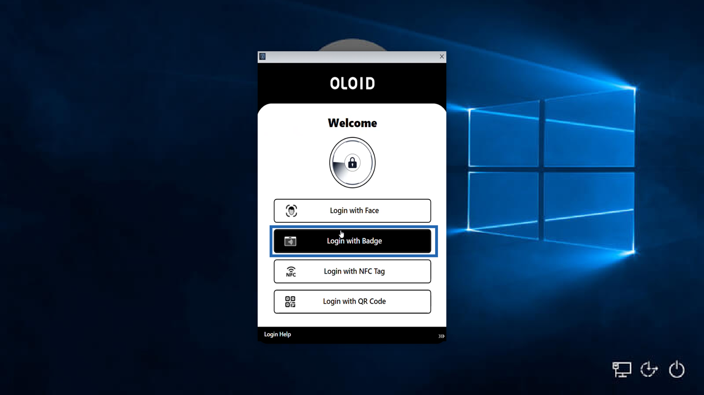
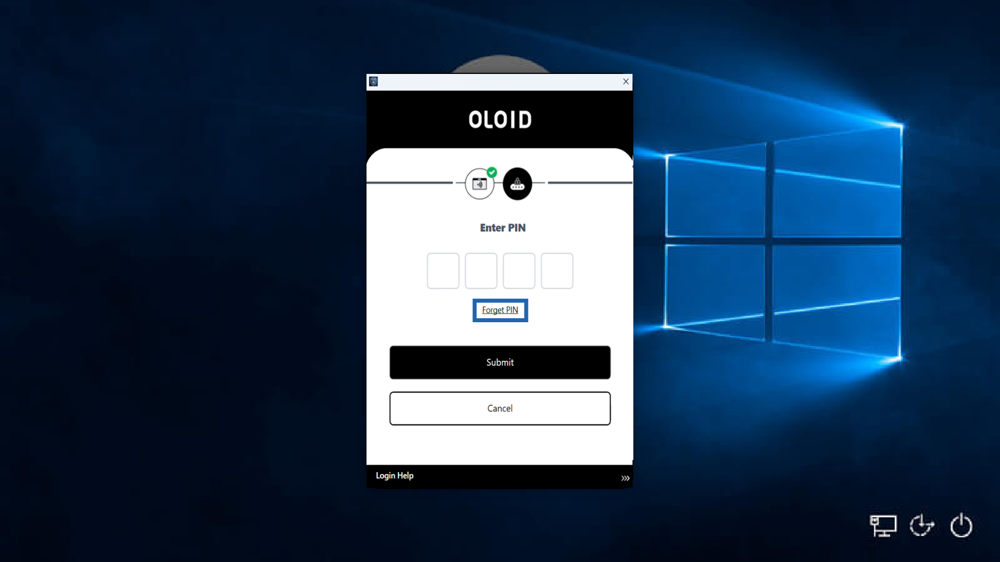
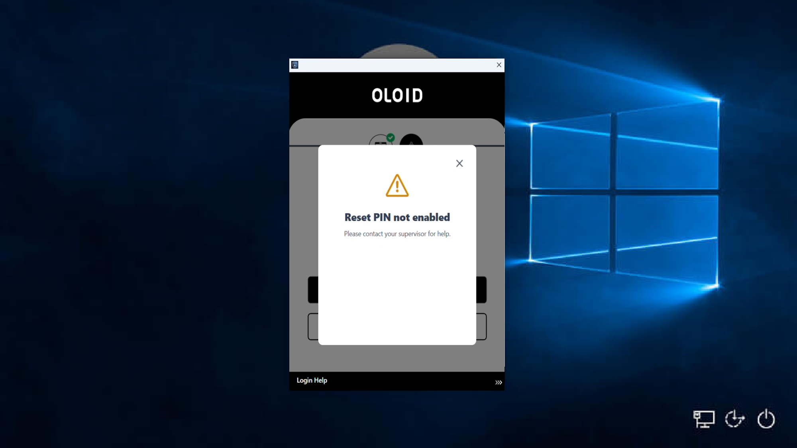
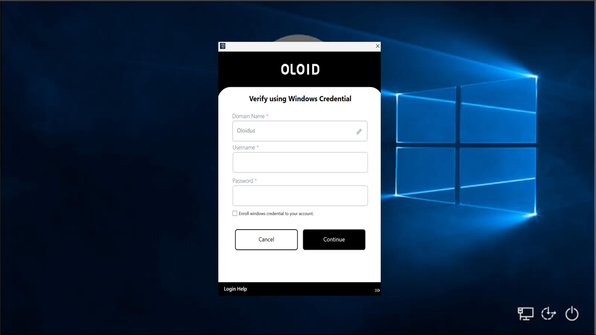
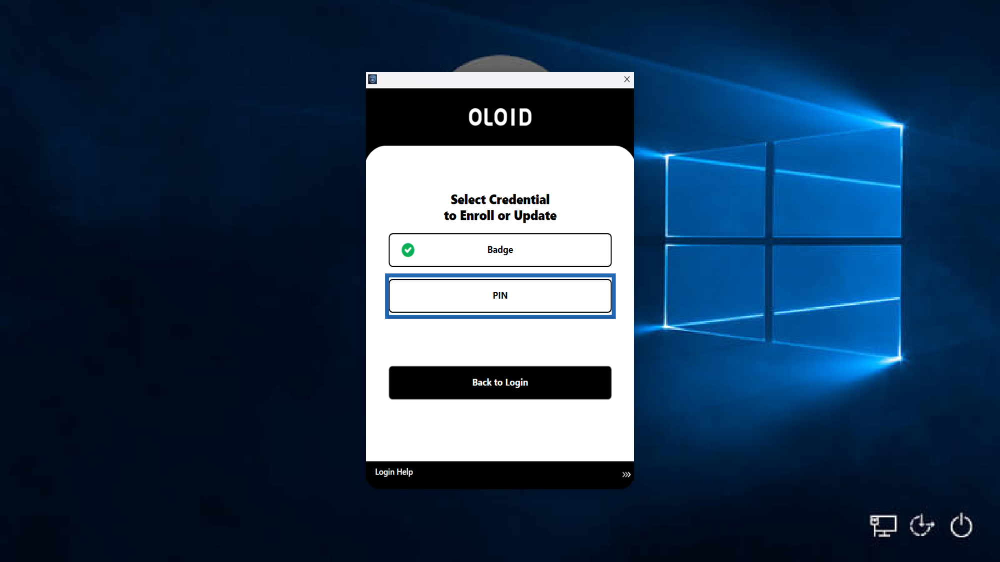
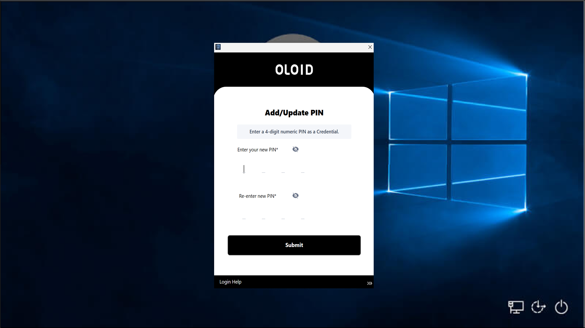
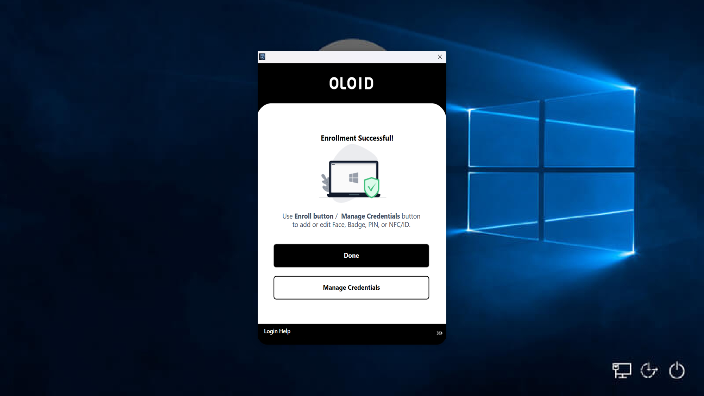

{/* Source: Intercom article 14074958 - https://oloid.help/en/articles/14074958-windows-login-how-to-reset-pin-in-windows-login-using-badge-and-forgot-pin */}
{/* Generated by intercom_to_mintlify.py - re-running overwrites this file. */}

## Introduction

This document explains how users can reset their PIN credential in Windows Login if they have forgotten their existing PIN. The Forgot PIN feature allows users to securely reset their PIN directly from the Windows Login screen after authenticating with another credential such as a Badge.

## Prerequisites

- The **Forgot PIN** toggle must be enabled and configured in the Tenant Admin Portal. For more, refer to [How to Enable Forgot PIN Link in Windows Login Application](/platforms/windows/windows-login/windows-login-how-to-enable-forgot-pin-link-for-windows-login)
- The Badge reader is connected to the Windows device.
- The user must have a valid Badge credential assigned.

## Steps to Reset PIN from Windows Login Screen

1. On the Windows lock screen, do the following:
   1. Click **Sign-in options**.

      

      The Windows login app is displayed.
   2. Select **Windows login app**.

      

   3. Select **Login with OLOID**.

      

      The Windows login app opens and the **Welcome** page is displayed.
2. On the **Welcome** page, Click **Login with Badge.**

   

   The **Scan Badge at the Reader** page is displayed.
3. Tap the **Badge** on the **Badge Reader** to scan it.

   

   On Badge authentication, the **Enter PIN** pop-up box is displayed.

Click **Forgot PIN.**

<Note>
  **Note:** Depending on how the Tenant Admin configured the feature, one of the following occurs:
</Note>

## Option 1: Show Popup

A popup message appears with instructions to reset the PIN.

## Option 2: PIN enrollment using Windows credential verification

4. The system redirects you to the **Verify using Windows Credential page**.
   From this page, reset your PIN following the Windows credential management process.
   The **Verify using Windows Credential** screen is displayed.
1. Do the following:
   1. Enter **Domain name**.
   2. Enter **Username**.
   3. Enter **Password**.

      <Note>
        **Note:** Use your Windows account password.
      </Note>

   4. Select **Enroll Windows credential to your account**. (Optional)
   5. Click **Continue**.

      

      The **Select Credential to Enroll or Update** screen is displayed.
2. Click **PIN**.

   

   The Add/Update PIN page is displayed
3. Do the following:
   1. Enter **new PIN.**
   2. **Re-enter new PIN**.
   3. Click **Submit**.

      <Note>
        **Note:** You can configure PIN credentials in the Tenant Admin Portal. For more details, refer to [How to configure PIN](/platform/tenant-admin-portal/tenant-admin-portal-how-to-configure-pin)
      </Note>

      

      The PIN credential is reset successfully.

      
