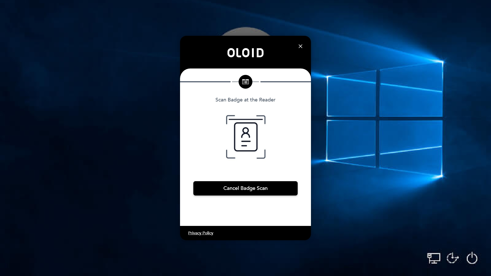
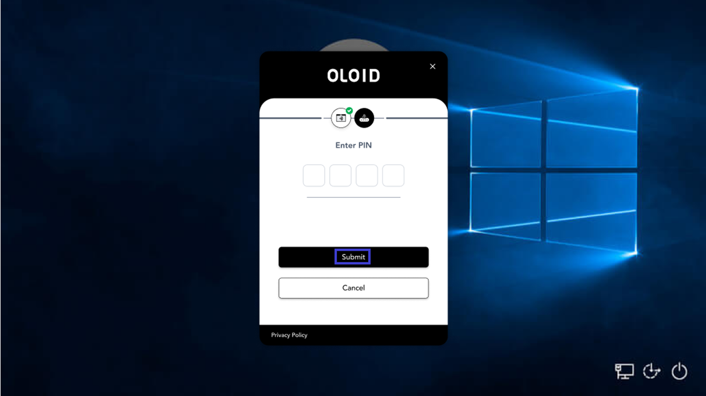

{/* Source: Intercom article 14338271 - https://oloid.help/en/articles/14338271-windows-login-how-to-sign-in-with-a-passkey */}
{/* Generated by intercom_to_mintlify.py - re-running overwrites this file. */}

## Introduction

This document provides an overview of how to login to Windows device when passkey is enabled, and how the authentication is processed on the Windows device.

## Prerequisites

- The device must be running Windows Pro.
- OpenVPN must be connected.
- The user should have a domain account.
- A passkey must be created for the user. For more information, refer to [How to Create Passkey for a User in Windows Supervisor App](/platforms/windows/supervisor-app/windows-login-how-to-create-passkey-for-a-user-in-supervisor-app)
- The **Enable Passkey** toggle must be turned on in the Tenant Admin Portal. For more information, refer to [Oloid Platform - How to enable Passkey in Tenant Admin Portal for Windows Login](/platforms/windows/windows-login/windows-login-how-to-enable-passkey-in-tenant-admin-portal-for)

## Steps to Sign In to a Windows Device with a Passkey

1. On the Windows lock screen, do the following:
   1. Click **Sign-in options**.

      

      The Windows login app is displayed.
   2. Select **Windows login app**.

      

   3. Select **Login with OLOID**.

      

      The Windows login app opens and the **Scan Badge** page is displayed.
2. Tap the **Badge** on the **Badge Reader** to scan it.

   

   After your badge is verified, the **Enter PIN** pop-up is displayed.
3. Enter the **PIN** then click **Submit**.

   

   On PIN authentication, you are signed in to the Windows device.

   <Note>
     **Note:** If you have multiple passkeys configured in the Oloid Portal, the **Choose Your Account** page is displayed. Select the account you want to sign in to.
   </Note>

   

### Passkey Authentication Flow

When a user initiates login on the Oloid authentication page, the system is prompted to authenticate using a previously registered passkey. The authentication request is handled by the user’s device, where the user verifies their identity Oloid Credentials, this verification happens locally on the device.

Once the user is successfully verified, the device generates a secure authentication response and sends it to the server. The server validates this response using the registered credentials and, upon successful verification, grants the user access to the application.

This ensures that sensitive credential handling is confined to the device and backend systems, with no passwords being transmitted or exposed. As a result, passkey authentication provides a secure and seamless login experience while minimizing the risk of phishing and credential theft. If authentication fails, the system proceeds with fallback authentication methods if they are configured.
