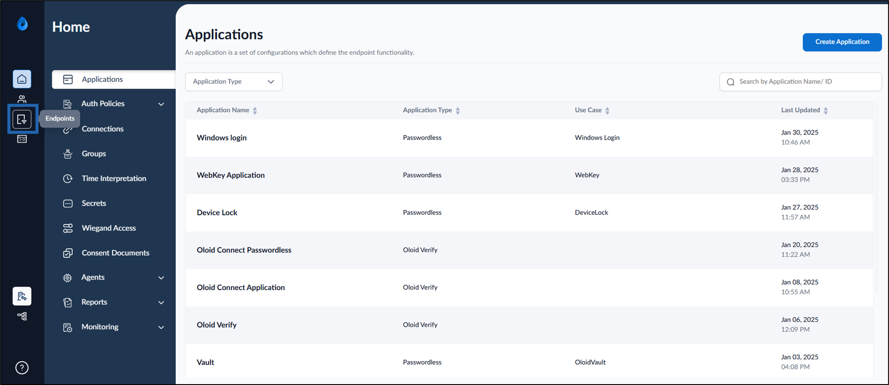
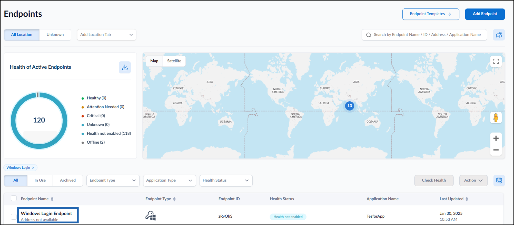
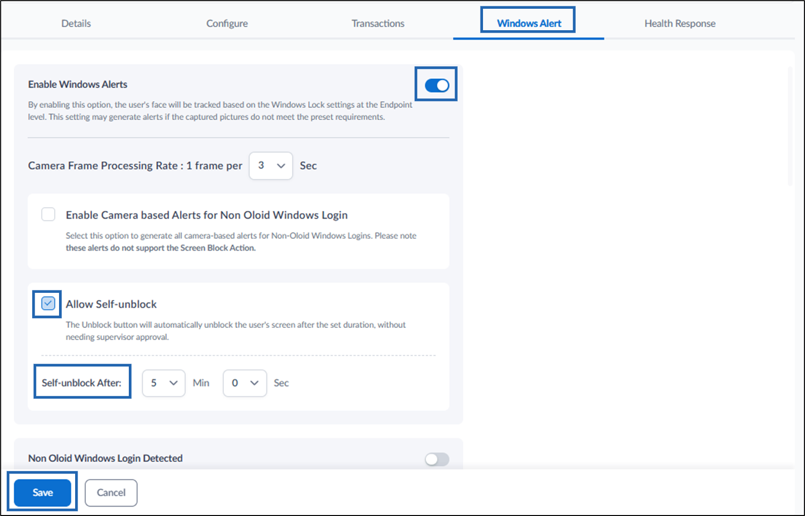

{/* Source: Intercom article 10489306 - https://oloid.help/en/articles/10489306-windows-login-presence-detection-platform-configuration-for-self-unblock */}
{/* Generated by intercom_to_mintlify.py - re-running overwrites this file. */}

**Introduction:**

The self-unblock feature in Windows Login app (Presence Detection) automatically unlocks the user's screen after the specified duration, eliminating the need for Supervisor approval.

**Steps to configure self unblock:**

1. Log in to **Oloid Portal**.
2. On the homepage, select **Endpoint** from the left menu panel.

   

   The **Endpoints** page is displayed.
3. Select an endpoint (Windows Login) to edit.

   

   The **Details** page is displayed.
4. Go to **Windows Alert** tab and do the following
   1. Turn on **Enable Windows Alert**.
   2. Select **Allow Self-unblock**.
   3. Set the duration in **Self Unblock After** field after which the user can automatically unblock themselves without supervisor approval.
   4. Click **Save**.

      

      The Self-unblock is configured for the Endpoint successfully.
