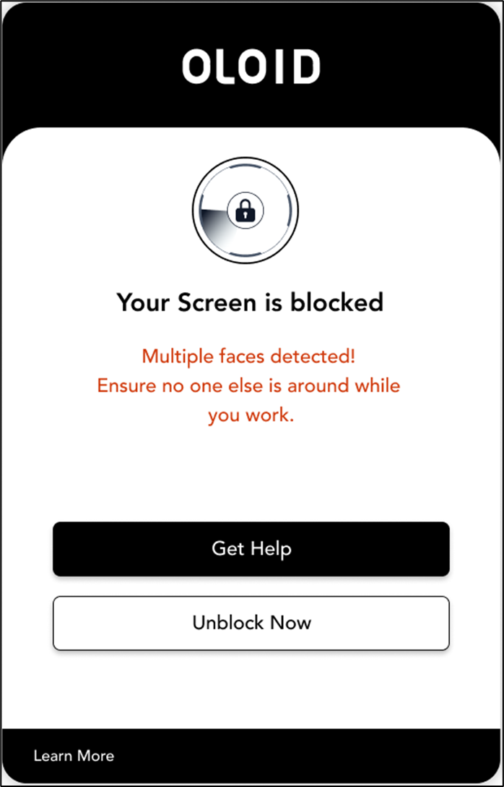
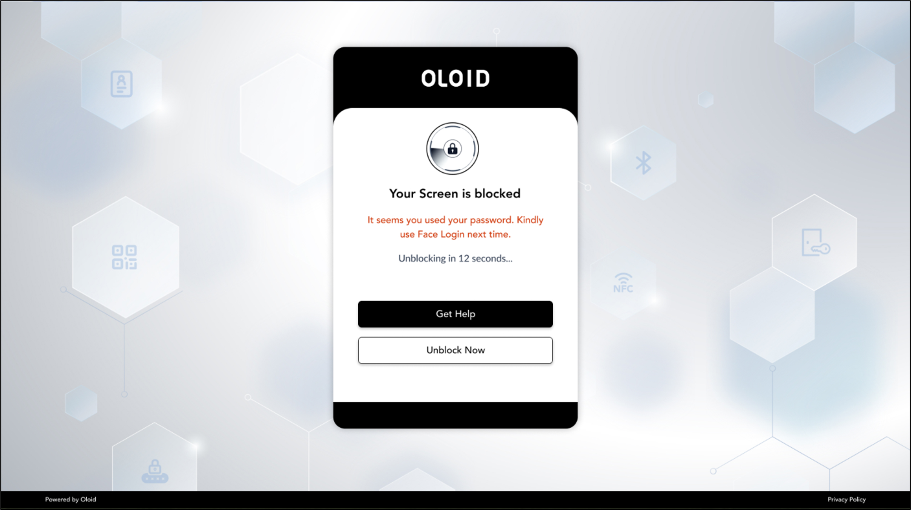

{/* Source: Intercom article 10001674 - https://oloid.help/en/articles/10001674-windows-login-screen-block-on-multiple-faces-detected */}
{/* Generated by intercom_to_mintlify.py - re-running overwrites this file. */}

## Screen block on Multiple faces detected

Your windows endpoint supports the screen block on multiple face detection functionality with Oloid's Presence detection feature.

The Windows system will automatically get blocked if the camera detects multiple faces. The screen displays a screen block message.

<Note>
  **Note:** All screen interactions are disabled, except for the buttons shown on the blocked screen.
</Note>

## Requirement for Presence Detection Feature

1. Your Windows endpoint must be registered for Presence Detection.
2. Relevant Windows Agent should be installed to support the Presence Detection feature.
3. The "Multiple Faces Detected" option must be enabled by your admin at the endpoint level.

## Steps to Take if Your Screen is Blocked

1. **Click "Get Help" to contact your Support team and report screen block.**
   - The Support Team will notify your Supervisor of the event.
   - The Supervisor will review and unblock your screen.
2. **Click "Unblock Now" after Supervisor confirms of screen unblock.**
   - Your screen will be unblocked, and you can resume work.
3. **If the screen remains blocked and the "Unblock Failed" popup appears:**
   - Contact your Supervisor to reach out to Oloid Support.

     <Note>
       **Note:** Without Supervisor approval, your screen will automatically be unblocked after the specified time duration if auto unblock is enabled for that endpoint.
     </Note>

     For more information on auto unblock, see [How the Self-Unblock Feature Works in Windows Login Presence Detection](/platforms/windows/windows-login/how-the-self-unblock-feature-works-in-windows-login-presence-detection)

     
