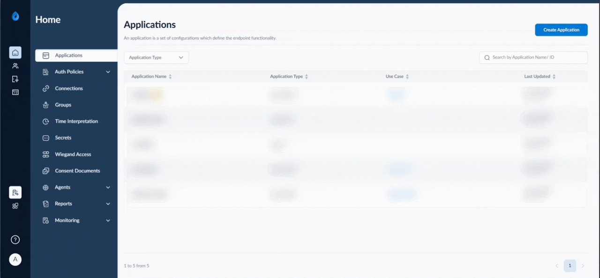

{/* Source: Intercom article 13332126 - https://oloid.help/en/articles/13332126-oloid-platform-qrg-how-to-create-secrets */}
{/* Generated by intercom_to_mintlify.py - re-running overwrites this file. */}

## Steps to create Secrets

1. On the Tenant Admin homepage click **Home** > **Secrets**.
2. On the Secrets list page click **Create Secrets**.
3. Enter **Secret name**, **Key Value pair** > click **Save**.
   The Secret is successfully created.
