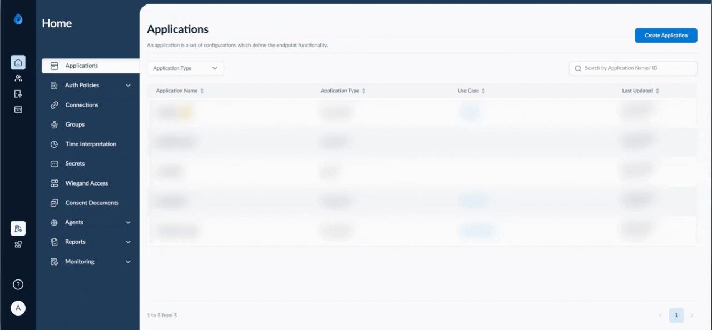

{/* Source: Intercom article 13183629 - https://oloid.help/en/articles/13183629-oloid-platform-qrg-how-to-generate-auto-pair-config-file */}
{/* Generated by intercom_to_mintlify.py - re-running overwrites this file. */}

## Steps to Generate Auto-pair config file

1. On the Tenant Admin homepage click **Profile Icon > Tenant Settings**
2. On the Tenant Settings page click **Security tab.**
3. Click **API key >** Enter **Start and End Date >** click **Generate.**

For more details refer:

[How to generate Auto-Pair config file for Oloid Connect in Tenant Admin Portal](/platforms/ios/time-clock/oloid-connect/oloid-connect-how-to-generate-auto-pair-config-file-in-the-tenant)

[How to generate Auto-Pair config file for Windows Login in Tenant Admin Portal](/platform/tenant-admin-portal/windows-login-how-to-generate-and-download-auto-pair-config-file-for)

[How to Generate Auto-Pair Config File for Oloid DeviceLock App in the Tenant Admin Portal](/platforms/android/devicelock/devicelock-app-how-to-generate-auto-pair-config-file-in-the-tenant)
