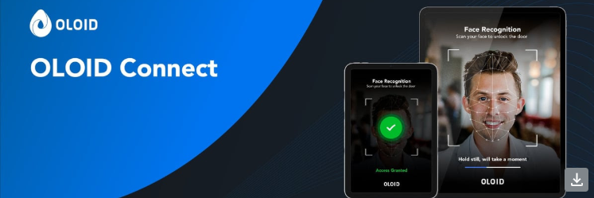
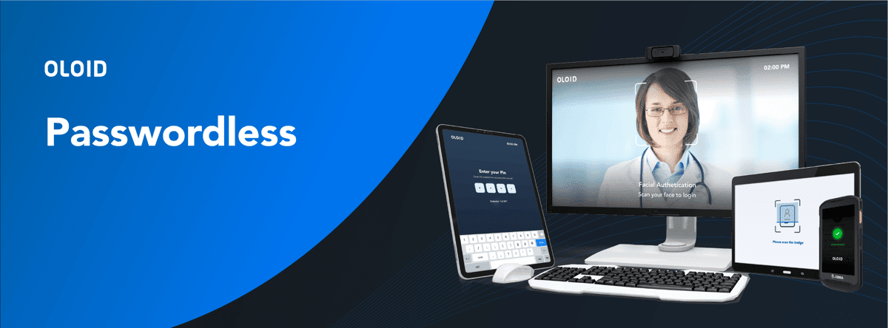

{/* Source: Intercom article 10315274 - https://oloid.help/en/articles/10315274-oloid-product-updates */}
{/* Generated by intercom_to_mintlify.py - re-running overwrites this file. */}

## Oloid Connect

### RELEASE UPDATE - AUGUST 2025

#### What's New

- **Face as Second Factor**
  - Users can now use face authentication as an additional security factor, enhancing both convenience and protection.

- **Liveliness Check for Second Factor**
  - A liveliness check has been integrated into the face authentication process when used as the second factor. This ensures real-time identity verification and strengthens security by preventing spoofing or presentation attacks.

## Oloid Passwordless

### December Updates - 2024

**Introducing Version 1.0.13**

- **Self-Enrollment Made Easy**
  With our new self-enrollment feature, users can effortlessly enroll without needing assistance from tenant admins or supervisors.
- **Presence Detection for Enhanced Security**
  Automatically lock your desktop when you step away, send supervisor alerts, and protects against unauthorized devices for added protection.

---

### November Updates - 2024

**Introducing Version 1.1.27**

- **Auto-Unblock for a Hassle-Free Experience**
  Automatically unlocks your screen after a successful login using Windows credentials.
- **Improved Blocked Screen Messaging**
  Updated messages now include a timer for Auto-Unblock, keeping you informed at a glance.
